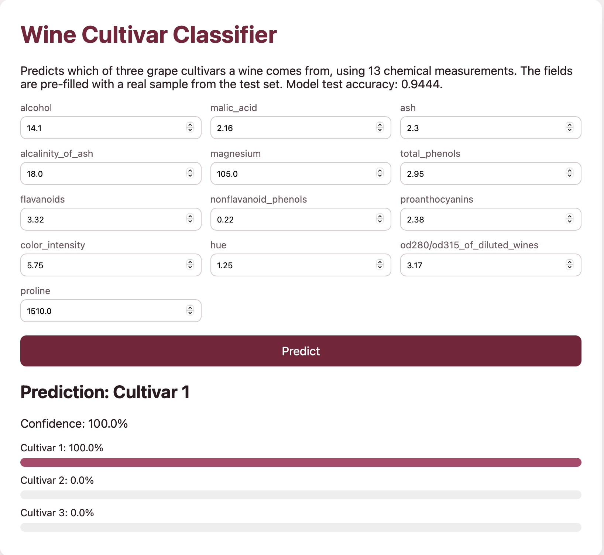

# MLOps Lab 3 – Containerized Wine Classifier with Docker

A machine learning app that runs entirely in Docker. One container stage trains a model, and another serves it through a web page and a JSON API. Enter 13 chemical measurements of a wine, and the app predicts which of three grape cultivars it comes from.

Based on **Docker_Labs / Lab2** from the MLOps course (IE7305). The original lab trained a TensorFlow neural network on the Iris dataset and served it with Flask. This version changes the dataset, the model and, mainly, the Docker setup. All changes are listed in [Changes from the original lab](#changes-from-the-original-lab), with measured before/after results.

---

## 1. Requirements

You only need Docker and Git. Python and all packages run inside the containers, so nothing else has to be installed.

| Tool | Version used | Check with |
|---|---|---|
| Docker Desktop (includes Docker Compose) | Docker 29.9.2 | `docker --version` |
| Git | any recent version | `git --version` |

Tested on macOS (Apple M4). Docker Desktop is available for Mac, Windows and Linux at https://www.docker.com/products/docker-desktop/. Make sure Docker Desktop is open and shows "Engine running" before running any command below.

Packages installed inside the images (pinned):

| Image stage | Packages |
|---|---|
| Base image | `python:3.13-slim` |
| Training (`requirements-train.txt`) | scikit-learn 1.9.1, joblib 1.6.0 |
| Serving (`requirements-serve.txt`) | scikit-learn 1.9.1, joblib 1.6.0, Flask 3.1.3, gunicorn 26.2.0 |

---

## 2. Get the code

    git clone https://github.com/DiyaKaswa11/MLOps_Lab3_Docker.git
    cd MLOps_Lab3_Docker

All commands below are run from this folder.

## 3. Run it (choose one option)

### Option A: Docker Compose (recommended)

    docker compose up --build -d

This builds both images, runs the **trainer** container (which trains the model and saves it to a shared volume, then exits), and then starts the **serving** container.

Check that it worked:

    docker compose ps -a

Expected: `trainer` shows `Exited (0)` and `serving` shows `Up ... (healthy)`. The health status can take up to about 30 seconds to appear.

See the training results:

    docker compose logs trainer

Expected: a classification report for the three cultivars, followed by:

    Test accuracy: 0.9444
    Model version: <date and time>
    Saved model and metadata to /app/artifacts

Stop everything with:

    docker compose down

### Option B: Plain Docker (single image)

    docker build -t wine-serving .
    docker run -d -p 8000:8000 --name wine wine-serving

The model is trained during the build and copied into the final image. Check it with `docker ps`; the STATUS column shows `(healthy)` after about 30 seconds. Stop and remove it with:

    docker rm -f wine

## 4. Use the app

**Web page:** open http://localhost:8000. The 13 fields are pre-filled with a real sample from the test set. Click **Predict** to see the predicted cultivar, the confidence and a probability bar for each cultivar (see the screenshot above).

**API, from a second terminal:**

Health check:

    curl http://localhost:8000/health

Expected:

    {"model_version":"<date and time>","status":"healthy"}

Model details (dataset, model, hyperparameters, accuracy, F1 score, feature names):

    curl http://localhost:8000/model-info

Prediction:

    curl -X POST http://localhost:8000/predict -H "Content-Type: application/json" -d '{"alcohol": 14.1, "malic_acid": 2.16, "ash": 2.3, "alcalinity_of_ash": 18.0, "magnesium": 105.0, "total_phenols": 2.95, "flavanoids": 3.32, "nonflavanoid_phenols": 0.22, "proanthocyanins": 2.38, "color_intensity": 5.75, "hue": 1.25, "od280/od315_of_diluted_wines": 3.17, "proline": 1510.0}'

Expected:

    {"class_id":0,"confidence":1.0,"predicted_class":"Cultivar 1","probabilities":{"Cultivar 1":1.0,"Cultivar 2":0.0,"Cultivar 3":0.0}}

Incomplete input returns status 400 with a message listing the missing features:

    curl -X POST http://localhost:8000/predict -H "Content-Type: application/json" -d '{"alcohol": -1}'

## 5. Change the model settings without rebuilding

The training settings are environment variables. With Docker Compose you can retrain with different values without changing code or rebuilding:

    N_ESTIMATORS=50 MAX_DEPTH=2 docker compose up -d --force-recreate

Then `curl http://localhost:8000/model-info` shows `"n_estimators": 50`, `"max_depth": 2` and a new `model_version`. The new model reaches the serving container through the shared volume.

| Variable | Default | Meaning |
|---|---|---|
| `N_ESTIMATORS` | 200 | Number of boosting stages (trees) |
| `LEARNING_RATE` | 0.1 | Learning rate |
| `MAX_DEPTH` | 3 | Maximum depth of each tree |

On Windows PowerShell, set the variables first, for example `$env:N_ESTIMATORS=50`, and then run `docker compose up -d --force-recreate`.

---

## Changes from the original lab

### 1. Dataset
- **Iris** (150 flowers, 4 features) was replaced with the **Wine** dataset from scikit-learn (178 wines, 13 chemical features, 3 cultivars).
- Stratified 80/20 train/test split (142 training and 36 test samples).

### 2. Model
- The **TensorFlow neural network** was replaced with a scikit-learn **Pipeline of StandardScaler and GradientBoostingClassifier**.
- The model is now evaluated on the test set: **accuracy 0.9444, macro F1 0.9453**, with a full classification report printed during training.
- Training saves `metadata.json` (dataset, model, version, training date, hyperparameters, metrics, feature and class names), which the app serves at `/model-info`.

### 3. Docker (the main part of this lab)

Measured on the same Mac. Both builds include downloading their base image.

| | Original | This version |
|---|---|---|
| Image size on disk | 4.15 GB | **585 MB** (about 86% smaller) |
| Image content size | 1.08 GB | **126 MB** (about 88% smaller) |
| Build time | 121.7 s | **26.1 s** |
| Web app reachable after `docker run` | No | Yes |

- **Fixed the port bug.** The original Dockerfile exposed port 80 and Compose mapped 80:80, but Flask listened on port 4000, so the app could not be reached. Running the original image with `-p 80:80` gave `curl: (56) Recv failure: Connection reset by peer`, and the container logs showed Flask running on port 4000. Now the app, `EXPOSE`, the health check and the port mapping all use port 8000.
- **Smaller images.** Uses `python:3.13-slim` instead of the full `python:3.10` image, and removes TensorFlow.
- **Separate requirements per stage.** The original installed everything in both stages. Now the training stage installs only scikit-learn and joblib, and the serving stage adds only Flask and gunicorn.
- **Better layer caching.** Requirements are copied and installed before the code, so a code-only change does not reinstall packages.
- **Production server.** Replaced Flask's development server running with `debug=True` with **gunicorn** (2 workers).
- **Non-root user.** The serving container runs as `appuser` (`docker run --rm wine-serving whoami` prints `appuser`).
- **Health check.** A `HEALTHCHECK` calls `/health`, so `docker ps` and `docker compose ps` show `(healthy)`.
- **Docker Compose builds from the Dockerfile.** The original Compose file used plain Python images and ran `pip install` every time the containers started. Now it builds the `trainer` and `serving` stages from the Dockerfile, shares the model through a named volume, and starts serving only after training finishes successfully.
- **Configurable training** through environment variables (section 5).
- Added `.dockerignore`, Python environment settings (no `.pyc` files, unbuffered logs, no pip cache) and pinned package versions. Compose restarts the serving container automatically if it stops unexpectedly.

### 4. App and web page
- New endpoints: `/health` and `/model-info`. `/predict` accepts JSON or form data.
- Input validation: all 13 features are required, must be numbers and cannot be negative. Invalid input returns status 400 with a clear message instead of an error.
- The response includes the predicted cultivar, confidence and per-class probabilities, not only the class name.
- A new web page for the 13 Wine features, pre-filled with a real test sample, showing a probability bar for each cultivar.

---

## Project structure

    MLOps_Lab3_Docker/
    ├── Dockerfile                 # Multi-stage build: base, trainer, serving
    ├── docker-compose.yml         # Trainer and serving services with a shared model volume
    ├── .dockerignore
    ├── requirements-train.txt     # Packages for the training stage
    ├── requirements-serve.txt     # Packages for the serving stage
    ├── docs/
    │   └── web_app.png            # Screenshot of the web app
    └── src/
        ├── train.py               # Trains and evaluates the model, saves model and metadata
        ├── app.py                 # Flask app: web page and JSON API
        └── templates/
            └── index.html         # Web page

## Troubleshooting

- **`Cannot connect to the Docker daemon`**: Docker Desktop is not running. Open it and wait for "Engine running".
- **`port is already allocated`**: something else is using port 8000. Stop it (for example `docker rm -f wine` or `docker compose down`), or change the left side of the port mapping, for example `-p 8080:8000`, then open http://localhost:8080.
- **The page does not load right after starting**: wait a few seconds for the server to start, then refresh.
